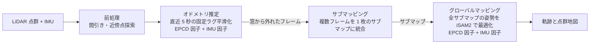
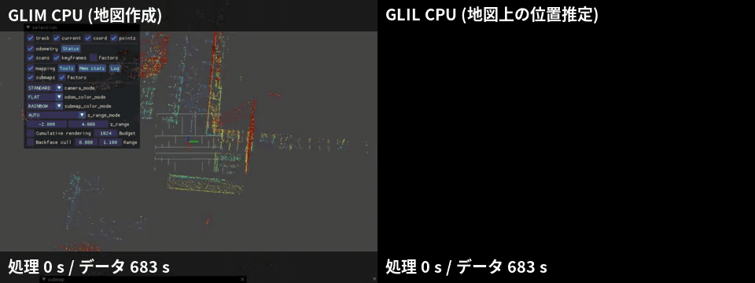

# EPCD フォーク CPU 版の仕組み

対象は [IkuoShige/glim](https://github.com/IkuoShige/glim) の `main` ブランチ、リリースタグ `epcd-v0.1.0`。
本家 [koide3/glim](https://github.com/koide3/glim) のコミット `1a197c9` (v1.2.2 から 10 コミット後) が土台。

この文書の目的は 2 つ。

- CPU だけで動く SLAM の処理の流れの説明
- 論文と本家 GLIM の通りに作った部分と、本フォークで足した部分の区別

文中の出典表記は次の 3 種類。

- 「EPCD 論文」は Koide ほか "Tightly Coupled Range Inertial Odometry and Mapping with Exact Point Cloud Downsampling" [1]。
- 「GLIM 論文」は Koide ほか "GLIM: 3D Range-Inertial Localization and Mapping with GPU-Accelerated Scan Matching Factors" [2]。
- 「本家」は koide3/glim の `master` (`1a197c9`) のコード。「独自」は `git diff 1a197c9 epcd-v0.1.0` に現れる変更。

## 概要

LiDAR 点群と IMU から、センサの軌跡と点群地図を作るシステム。
処理は 3 つのモジュールに分かれ、それぞれが別スレッドで動く。
この構成は GLIM 論文と本家の通り。

- オドメトリ推定。新しいフレームの姿勢・速度・IMU バイアスを、直近 5 秒分のフレームと一緒に最適化。
- サブマッピング。オドメトリの窓から外れたフレームを集め、1 枚の点群 (サブマップ) に統合。
- グローバルマッピング。重なりのあるサブマップの組すべてに位置合わせ誤差の因子を張り、地図全体の姿勢を最適化。ループは「重なりがあれば因子を張る」だけで閉じる仕組み (暗黙的ループ閉じ込み)。

本家 GLIM はオドメトリとグローバルマッピングの重い因子を GPU で計算する設計。
EPCD 論文は、点群の残差を数十から数百点に減らしても二次形式が変わらない厳密な間引き (exact coreset) を使い、同じ因子グラフを CPU で実時間処理する方法を示した論文。
本フォークは、この EPCD 論文の方法を本家 GLIM のコードに組み込み、CPU 版として動かすもの。
本家 GLIM には EPCD の因子 (`ExactGICPFactor`) が含まれていないため、因子そのものも本フォークでの実装。

## 本家と独自の対応表

| 構成要素 | 論文・本家 GLIM の通りの部分 | 本フォークの独自の工夫 | 該当コード |
|---|---|---|---|
| GICP 残差 | 分布対分布の距離 (EPCD 論文 式 (1)〜(4))。KdTree による厳密な最近傍探索 (EPCD 論文 III-C) | 因子の実装一式 (本家に EPCD 因子なし) | `src/glim/factors/exact_gicp_factor.cpp` `compute_perpoint` |
| 厳密 coreset | 線形化点での $H, b, c$ の完全保存 (EPCD 論文 III-A)。28 次元特徴と Fast-Carathéodory (参照実装 caratheodory2) | Carathéodory 縮約の零空間計算を $D+1$ 列に限定。インライアが目標点数以下なら全点を重み 1 で再利用。2 変数因子のターゲット側ブロックも保存されることを単体テストで確認 | `exact_gicp_factor.cpp` `reduce_caratheodory` `fast_caratheodory` `extract_coreset` |
| coreset の作り直し | 遅延抽出 0.25 m / 0.25°、作り直し 1.0 m / 1.0° (EPCD 論文 III-A) | なし (論文通り) | `exact_gicp_factor.cpp` `evaluate_for_linearize` |
| coreset の即時抽出 | なし | 全点評価の直後に coreset を抽出し、28 次元特徴をすぐ解放。線形化の結果は遅延抽出と同一 | `evaluate_for_linearize`、設定 `epcd_eager_coreset_extraction` |
| オドメトリ推定 | 5 秒窓の iSAM2 固定ラグ平滑化、IMU 事前積分因子、直前フレームとキーフレームへの位置合わせ因子 (GLIM 論文 IV-B、EPCD 論文 III-C)。キーフレーム管理の手順は本家 GPU 版のコード | 本家 CPU 版 (iVox 地図への scan-to-model 位置合わせ) とは別の経路として、GPU 版の因子構成を EPCD 因子で CPU に移植。キーフレーム追加の判定は各キーフレームとの重なり率の最大値 | `src/glim/odometry/odometry_estimation_cpu.cpp` |
| 平滑化のスレッド数 | iSAM2 更新を TBB の task arena で実行 (本家、スレッド数 1 に固定) | 設定項目 `num_smoother_update_threads` | `src/glim/odometry/odometry_estimation_imu.cpp:84`、`:125` |
| サブマッピング | 全キーフレーム対の位置合わせ因子、LM 一括最適化、中心フレームを原点とするサブマップ (GLIM 論文 V-A) | 因子の種類に `EPCD_GICP` を追加 | `src/glim/mapping/sub_mapping.cpp:311` |
| 重なり率の計算 | 8×8×8 ボクセルを 512 ビットに詰めた占有格子 (EPCD 論文 III-B、gtsam_points の `FastOccupancyGrid`) | グローバルマッピングの重なり率を本家の voxelmap 方式から占有格子に置き換え | `src/glim/mapping/global_mapping.cpp:446`、`:734` |
| 暗黙的ループ閉じ込み | 100 m 以内で重なり率がしきい値以上の全サブマップ対に因子 (GLIM 論文 V-B、EPCD 論文 III-D) | なし (`enable_loop_verification` が false なら本家通り) | `global_mapping.cpp` `create_matching_cost_factors` |
| 検証付き暗黙的ループ閉じ込み | なし | 再訪問を粗密位置合わせで確認、時間的一貫性の確認、収束範囲外なら BetweenFactor で引き込み、範囲内に入れば位置合わせ因子に置き換え | `global_mapping.cpp` `create_verified_loop_factors` `align_coarse_to_fine` `confirm_loop` |
| メモリ削減 | なし | EPCD 因子の使用時に GaussianVoxelMap を作らない | `global_mapping.cpp:301` |
| iSAM2 の復旧 | 不定な線形系の例外で減衰因子を足し iSAM2 を作り直す (本家) | 同じ変数が再び報告されたら作り直しを止め、最適化を無効化。本家の無限再帰の解消 | `global_mapping.cpp:806` |
| 地図の保存と読み込み | 因子の種類を保存し、読み込み時に再生成 (本家) | 種類 `epcd_gicp` の追加、占有格子の再生成 | `global_mapping.cpp:881`、`:1167` |
| GPU 設定の誤用 | GPU 因子を CUDA なしで指定すると、グローバルマッピングはエラーを記録して続行、サブマッピングは因子を作らずに続行 (本家) | 例外で停止し、CPU 用設定を案内 | `sub_mapping.cpp:89`、`global_mapping.cpp` コンストラクタ |

## 記号

| 記号 | 意味 |
|---|---|
| $P_i, P_j$ | 2 つの点群 (フレームまたはサブマップ) |
| $T_i \in SE(3)$ | 点群 $P_i$ の姿勢 |
| $T_{ij} = T_i^{-1} T_j$ | $P_i$ から見た $P_j$ の相対姿勢 |
| $\mu_k, \Sigma_k$ | $P_j$ の点 $k$ の位置と共分散 (周りの面の形) |
| $\mu'_k, \Sigma'_k$ | $P_i$ の中で点 $k$ に最も近い点の位置と共分散 |
| $d_k \in \mathbb{R}^3$ | 点 $k$ の残差 |
| $\Omega_k$ | 点 $k$ の残差の重み行列 (情報行列) |
| $J_k \in \mathbb{R}^{3 \times 6}$ | $d_k$ の姿勢についてのヤコビアン |
| $H, b, c$ | 二次形式の係数 (ヘッセ行列、勾配ベクトル、定数) |
| $N$ | インライア点の数 (対応点が見つかった点の数) |
| $D$ | coreset 抽出に使う特徴ベクトルの次元 (本実装では 28) |
| $x_t = [T_t, v_t, b_t]$ | 時刻 $t$ の状態。姿勢、速度 $v_t \in \mathbb{R}^3$、IMU バイアス $b_t \in \mathbb{R}^6$ |
| $d_{\max}$ | 対応点探索の最大距離 `epcd_max_correspondence_distance` (プリセットでは 1.0 m) |

## GICP 残差と二次形式

### 残差の定義

EPCD 論文 式 (1)〜(4) の通り。
$P_j$ の各点 $k$ を正規分布 $(\mu_k, \Sigma_k)$ とみなし、$P_i$ の最近傍点 $(\mu'_k, \Sigma'_k)$ との距離を測る方式 (分布対分布の GICP [5])。

$$
d_k = \mu'_k - T_{ij}\,\mu_k
$$

$$
\Omega_k = \left(\Sigma'_k + R_{ij}\,\Sigma_k\,R_{ij}^\top\right)^{-1}
$$

$$
f_{\mathrm{GICP}}(P_i, P_j, T_{ij}) = \sum_{k} d_k^\top\,\Omega_k\,d_k
$$

ここで $R_{ij}$ は $T_{ij}$ の回転部分。
論文は $\Omega_k = \Phi_k \Phi_k^\top$ と分解して $\|\Phi_k^\top d_k\|^2$ と書くが、値は同じ。

### 二次形式

ガウス・ニュートン法では、現在の推定値 $\breve{T}_{ij}$ のまわりで残差を線形化し、次の二次形式を作る (EPCD 論文 式 (5))。

$$
f_{\mathrm{GICP}}(\breve{T}_{ij} \boxplus \Delta x) \approx \Delta x^\top H\,\Delta x + 2\,b^\top \Delta x + c
$$

点ごとの寄与を足し合わせた形に書くと次の通り。

$$
H = \sum_{k=1}^{N} H_k,\quad b = \sum_{k=1}^{N} b_k,\quad c = \sum_{k=1}^{N} c_k
$$

$$
H_k = J_k^\top \Omega_k J_k,\quad b_k = J_k^\top \Omega_k d_k,\quad c_k = d_k^\top \Omega_k d_k
$$

この「点ごとの寄与の和」という形が、次の章の厳密 coreset の前提。

### 実装の流れ

`compute_perpoint` が 1 点分を計算する関数。

1. 点 $\mu_k$ を現在の相対姿勢で変換。
2. ターゲット点群の KdTree で最近傍点を 1 つ探索。距離の 2 乗が $d_{\max}^2$ 以上なら、その点は外れ値として除外。
3. $\Omega_k$ を計算。逆行列が求まらない点は除外。
4. ソース側ヤコビアン $J_k$ と、2 変数因子ならターゲット側ヤコビアンを計算。
5. $H_k, b_k, c_k$ を返却。

対応点は線形化のたびに探し直す。
これは EPCD 論文 III-A の「coreset で再線形化するときも対応点を更新する」という記述の通り。

**本家との違い。** 追加。本家 GLIM に EPCD 因子はなく、CPU のグローバルマッピングは VGICP (ボクセル単位の近似最近傍) の因子。EPCD 論文 III-C は、厳密な最近傍探索のほうが最適化の収束が良いと述べている。

## EPCD の厳密 coreset

### 何を保存するか

coreset は、元の点の部分集合と重みの組。
EPCD 論文 III-A の要件は、線形化点 (サンプリング点) $\tilde{T}_{ij}$ において、重み付き部分集合の二次形式が元の点集合の二次形式と完全に一致すること。

$$
\tilde{H} = H,\quad \tilde{b} = b,\quad \tilde{c} = c
$$

一致するのはサンプリング点ただ 1 点での話。
姿勢が動けば対応点と $J_k$ が変わるため、一致の保証はなくなる。
論文 IV-A は、サンプリング点から離れても誤差が小さいことを KITTI で実験的に示している。

### 一致する理由

本実装では、インライア点 $k$ ごとに次の 28 次元の特徴ベクトルを作る (`evaluate_full`、`feature_dim`)。

$$
q_k = \begin{bmatrix} \mathrm{upper}(H_k) \\ b_k \\ c_k \end{bmatrix} \in \mathbb{R}^{28}
$$

- $\mathrm{upper}(H_k)$ は対称行列 $H_k$ の上三角 21 要素。
- $b_k$ は 6 要素、$c_k$ は 1 要素。

$H, b, c$ はすべて $q_k$ の和なので、$\sum_k q_k$ を保てば $H, b, c$ も保たれる。
ここで Carathéodory の定理を使う。
$D$ 次元空間の $N$ 個の点の重心は、そのうち高々 $D+1$ 個の点の凸結合 (重みが非負で合計 1 の重み付き平均) で表せる、という定理。

$$
\frac{1}{N}\sum_{k=1}^{N} q_k = \sum_{i \in S} \alpha_i\,q_i,\quad \alpha_i \ge 0,\quad \sum_{i \in S} \alpha_i = 1,\quad |S| \le D + 1
$$

両辺を $N$ 倍し、重みを $w_i = N\alpha_i$ とすれば次の式。

$$
\sum_{i \in S} w_i\,q_i = \sum_{k=1}^{N} q_k
$$

つまり $\sum_{i \in S} w_i H_i = H$、$\sum_{i \in S} w_i b_i = b$、$\sum_{i \in S} w_i c_i = c$ の完全一致。
近似ではなく等式なので「厳密」という呼び名。

特徴ベクトルの構成 (上三角 21 + 6 + 1 = 28) と、重みを $1/N$ で始めて最後に $N$ 倍する手順は、参照実装 caratheodory2 の `fast_caratheodory_quadratic` と同じ。
参照実装は残差 1 行ごとに特徴を作るのに対し、本実装は 1 点 (3 次元残差) ごとに特徴を作る。
和の形は変わらないので、一致の議論はそのまま成り立つ。

### 2 変数因子での扱い

位置合わせ因子は 2 つの姿勢 $T_i$ と $T_j$ をつなぐ因子 (2 変数因子)。
特徴ベクトルにはソース側のブロックしか入れていないが、ターゲット側も保存される。
残差は相対姿勢 $T_{ij}$ だけの関数なので、ターゲット側ヤコビアンはソース側ヤコビアンに全点共通の $6 \times 6$ 行列 $M = -\mathrm{Ad}(T_{ij}^{-1})$ を掛けたものになるため。

$$
H_{tt} = M^\top H_{ss} M,\quad H_{ts} = M^\top H_{ss},\quad b_t = M^\top b_s
$$

右辺はどれも $H_{ss}, b_s$ について線形なので、$H_{ss}$ と $b_s$ が一致すれば左辺も一致。
この説明は `feature_dim` のコメントにあり、単体テスト `test_binary_factor` が全点の場合と coreset の場合のヘッセ行列全体の一致を確認している。

### Carathéodory 縮約

$D+1$ 個まで減らす基本手順 (`reduce_caratheodory`)。
点を列ベクトル $p_1, \dots, p_m$、重みを $u_1, \dots, u_m$ (合計 1) とする。

1. 点の数が目標以下なら終了。
2. 先頭の $D+2$ 点を取り出す。$D$ 次元の $D+2$ 点は必ずアフィン従属なので、$\sum_i v_i p_i = 0$ かつ $\sum_i v_i = 0$ を満たす零でない $v$ が存在。
3. $v$ を LU 分解で計算。
4. $\alpha = \min_{v_i > 0} u_i / v_i$ を計算。
5. $u \leftarrow u - \alpha v$ に更新。重み付き和と重みの合計は変わらず、少なくとも 1 つの重みが 0 になる。
6. 重みが 0 になった点を削除して 1. に戻る。

**本家との違い。** 参照実装 caratheodory2 からの変更。参照実装は手順 2 で残り全点の差分 ($m-1$ 列) の零空間を求める。本フォークは先頭 $D+1$ 列の差分だけを使い、先頭ブロックの条件が良ければ部分ピボット LU で解く。理由は計算量の削減。取り除かれる点の性質は同じなので、一致の議論に影響なし (コミット `5259eed`)。

### Fast-Carathéodory

点が数千あると、上の手順を 1 点ずつ回すのは遅い。
Maalouf ほか [4] の Fast-Carathéodory は、点をまとめて減らす方法 (`fast_caratheodory`)。

1. 全点の重みを $u_k = 1/N$ に設定。
2. 点を番号順に $k$ 個 (`epcd_coreset_num_clusters`、既定 64) のかたまりに分割。
3. かたまりごとに、重みの合計と重み付き平均を計算。
4. $k$ 個の平均点に Carathéodory 縮約をかけ、残すかたまりを決定。
5. 残ったかたまりの全点を残し、各点の重みを「かたまりの新しい重み × 点の重み ÷ かたまりの元の重み」に更新。
6. 点の数が目標以下になるまで 2. から繰り返し。
7. 最後に重みを $N$ 倍。

### coreset の大きさ

- 下限は $D + 1 = 29$ 点 (`extract_coreset` の `min_target_num`)。
- 目標点数は `epcd_coreset_target_num_points` (既定・プリセットとも 96) と 29 の大きいほう。
- インライアが目標点数以下なら、縮約せずに全インライアを重み 1 で coreset として再利用。この場合も一致は自明 (コミット `0dd91f3`)。
- 縮約後の点数が目標を超えないことの保証 (コミット `183bd0a`)。

EPCD 論文 III-A によれば、coreset の大きさは元の残差の約 0.5〜5%。

### coreset を作り直す方針

EPCD 論文 III-A と図 3 の「遅延抽出 (deferred sampling)」の通り。
しきい値も論文の例と同じ値が既定値。

| 名前 | 設定キー | 既定値 | 役割 |
|---|---|---|---|
| 遅延抽出のしきい値 | `epcd_deferred_sampling_translation`、`epcd_deferred_sampling_rotation` | 0.25 m、0.25° | 全点評価した点から、この範囲内で次の線形化が来たら coreset を抽出 |
| 作り直しのしきい値 | `epcd_rebuild_translation`、`epcd_rebuild_rotation` | 1.0 m、1.0° | coreset のサンプリング点から、この範囲を出たら全点評価からやり直し |

線形化のたびの判定 (`evaluate_for_linearize`)。
$T$ は今回の相対姿勢、$T_{\mathrm{full}}$ は直前に全点評価した姿勢、$T_{\mathrm{core}}$ は coreset のサンプリング点。

1. coreset があり、$T$ が $T_{\mathrm{core}}$ から 1.0 m / 1.0° 以内なら、coreset の点だけで評価。
2. 全点評価の特徴が残っていて、$T$ が $T_{\mathrm{full}}$ から 0.25 m / 0.25° 以内なら、特徴から coreset を抽出し ($T_{\mathrm{core}} = T_{\mathrm{full}}$)、coreset の点で評価。
3. どちらでもなければ全点で評価し、28 次元特徴を保存して $T_{\mathrm{full}} = T$。

最適化の始めは姿勢が大きく動くため、抽出してもすぐ捨てることになる。
2. の条件で「姿勢が落ち着いてから抽出する」のが遅延抽出の狙い (EPCD 論文 III-A)。

手順 2. の coreset は $T_{\mathrm{full}}$ での一致を保証するもので、評価は今回の $T$ で行う。
論文の「抽出した coreset を現在の線形化点で評価し直す」という記述の通り。

なお、因子の誤差値だけを求める `evaluate` (`error()` から呼ばれる) は常に全点で計算。

### coreset の即時抽出

本フォークの追加 (`epcd_eager_coreset_extraction`、コミット `ed15627`)。

遅延抽出では、手順 3. で保存した 28 次元特徴 (インライア 1 点あたり 28 個の double) を、次の線形化まで持ち続ける。
グローバルマッピングでは、この特徴が大半の因子に残ったままになる (`docs/parameters.md` の説明)。

即時抽出の手順。

1. 全点評価の直後に coreset を抽出し、特徴を解放。
2. 次の線形化で、$T$ が $T_{\mathrm{full}}$ から遅延抽出のしきい値以内なら、その coreset を使用。
3. しきい値の外なら coreset を捨て、全点評価からやり直し。

2. と 3. の分岐は、遅延抽出が coreset を抽出する場合としない場合にそのまま対応。
そのため線形化の結果は遅延抽出と同じ。
単体テスト `test_eager_matches_deferred` が、しきい値の内外をまたぐ線形化の列で両者のヘッセ行列の一致と、即時抽出のほうがメモリ使用量が小さいことを確認。

**本家との違い。** 追加。理由はグローバルマッピングのメモリ削減。代わりに、すぐ捨てられる coreset の抽出に計算時間を払う設計。プリセットではグローバルマッピングだけで有効。

## オドメトリ推定

### 因子グラフ

GLIM 論文 IV-B と EPCD 論文 III-C の通りの構成。

- 最適化の窓は直近 5 秒 (`smoother_lag`)。窓から出たフレームは周辺化 (marginalize) し、その情報を $f_{\mathrm{MG}}$ として残す。
- 連続フレーム間に IMU 事前積分因子 [7]。
- 新しいフレームと直前 $N_{\mathrm{pre}}$ フレームの間に位置合わせ因子。速い動きへの対策。
- 新しいフレームとキーフレームの間に位置合わせ因子。ドリフトの抑制。
- 最適化は GTSAM の iSAM2 [6] による固定ラグ平滑化。

目的関数は EPCD 論文 式 (6)(7)。

$$
g_{\mathrm{LIO}}(\mathcal{X}_w) = \sum_{x_j \in \mathcal{X}_w} \sum_{x_i \in \mathcal{X}^p_j \cup \mathcal{X}^k} f_{\mathrm{GICP}}(P_i, P_j, T_i, T_j) + \sum_{x_i \in \mathcal{X}_w} f_{\mathrm{IMU}}(x_{i-1}, x_i) + f_{\mathrm{MG}}(\mathcal{X}_w)
$$

- $\mathcal{X}_w$ は窓の中の状態の集合。
- $\mathcal{X}^p_j = \{x_{j-N_{\mathrm{pre}}}, \dots, x_{j-1}\}$ は $x_j$ の直前のフレーム。
- $\mathcal{X}^k$ はキーフレームの集合。

### 1 フレームの処理

`OdometryEstimationCPU::create_frame` と `create_factors`、`update_frames`。

1. 点群の距離の中央値から voxel 解像度を決め、重なり率用の占有格子 (`FastOccupancyGrid`) を作成。
2. 直前 $N_{\mathrm{pre}}$ フレーム (`epcd_full_connection_window_size`、プリセットでは 2) との間に 2 変数の EPCD 因子を作成。
3. 各キーフレームとの間に EPCD 因子を作成。窓から外れたキーフレームは姿勢を固定値とし、1 変数の因子に変更。
4. 1 回の因子作成の中では、同じターゲット点群の KdTree を 1 回だけ作り、因子の間で共有。
5. IMU 因子と合わせて iSAM2 を更新。
6. キーフレームの集合を更新。

### キーフレームの管理

既定の `OVERLAP` 方式の手順。本家 GPU 版 (`odometry_estimation_gpu.cpp` の `update_keyframes_overlap`) と同じ流れ。

1. 新しいフレームとキーフレームの重なり率が `epcd_keyframe_max_overlap` (プリセット 0.7) を超えていれば、キーフレームに追加しない。
2. 追加した結果、数が `epcd_max_num_keyframes` (プリセット 7) を超えたら、新しいキーフレームとの重なり率が `epcd_keyframe_min_overlap` (プリセット 0.01) 未満のキーフレームを削除。
3. まだ超えていれば、次のスコアが最小のキーフレームを 1 つ削除。

$$
s_i = o(i, \mathrm{latest}) \cdot \left(1 - o(i, \mathrm{others})\right)
$$

$o(i, \mathrm{latest})$ はキーフレーム $i$ と最新キーフレームの重なり率、$o(i, \mathrm{others})$ は他のキーフレームをまとめたものとの重なり率。

**本家との違い。** 変更。
本家の CPU 版オドメトリは、iVox の局所地図に新しいフレームを合わせ (scan-to-model)、結果を BetweenFactor と PriorFactor として平滑化に入れる方式。キーフレームを使う因子構成は本家では GPU 版だけ。
本フォークは `registration_type` が `EPCD_GICP` のとき、GPU 版の因子構成を EPCD 因子と KdTree で CPU 上に作る経路を追加。理由は、GLIM 論文と EPCD 論文の因子グラフを CPU で使うため。
手順 1. の判定は、本家 GPU 版が全キーフレームの和集合との重なり率を使うのに対し、本フォークは各キーフレームとの重なり率の最大値を使用。
重なり率の計算は、本家 GPU 版の voxelmap ではなく EPCD 論文 III-B の占有格子。

### 平滑化のスレッド数

iSAM2 の更新は TBB の task arena の中で動き、そのスレッド数が因子の線形化の並列度を決める。
本家はこのスレッド数を 1 に固定。
本フォークは設定項目 `num_smoother_update_threads` に変更 (既定 1、プリセット 4)。
プリセットの注記の理由は、再線形化が窓全体の因子をまとめて扱うため、並列化の効果があるという判断。
TBB 付きでビルドした GTSAM (`GTSAM_USE_TBB`) でのみ有効な設定。
README の推奨ビルドは GTSAM を TBB なしでビルドするため、この設定は効果なし。並列化は因子内部の OpenMP (`num_threads`) が担当。TBB 版 GTSAM との比較で速度差がなかったことが、TBB なしを推奨する理由 (「このマシンでの速度」の節)。

**本家との違い。** 変更。既定値は本家と同じ 1。

## サブマッピング

GLIM 論文 V-A と本家の通りの処理。

1. オドメトリの窓から外れたフレームを受け取り、確定した状態で歪み補正と共分散推定をやり直し。
2. 直前のキーフレームとの重なり率がしきい値 (`max_keyframe_overlap`、プリセット 0.6) 未満ならキーフレームに追加。
3. キーフレームのすべての組に位置合わせ因子、連続フレーム間に IMU 因子を追加。
4. キーフレーム数が `max_num_keyframes` (15) に達したら LM 法で一括最適化。
5. 中心のフレームを原点とし、全フレームを 1 枚のサブマップに統合。最初と最後のフレームの状態は、グローバルマッピングの IMU 因子用の端点として保存。

**本家との違い。** 追加。手順 3. の因子の種類に `EPCD_GICP` を選べるようにした変更。
プリセット `config/epcd_livox_budget` は、本家の CPU 用設定と同じく `enable_optimization` が false。この場合、手順 4. の最適化は行わず、オドメトリの推定値のままフレームを統合。

## グローバルマッピング

### 本家の暗黙的ループ閉じ込み

GLIM 論文 V-B、EPCD 論文 III-D、本家の通りの処理。

1. 新しいサブマップを受け取る。
2. 過去の全サブマップのうち、原点間の距離が `max_implicit_loop_distance` (100 m) 以内のものを候補に選択。
3. 候補との重なり率が `min_implicit_loop_overlap` 以上なら、その組に位置合わせ因子を追加。
4. 前のサブマップの右端点と新しいサブマップの左端点の間に IMU 因子を追加 (GLIM 論文 V-B の端点の仕組み)。
5. iSAM2 で増分最適化。

目的関数は EPCD 論文 式 (8)。$\mathcal{X}_o$ は重なりのあるサブマップの組の集合、$S_i$ はサブマップ $i$ の点群。

$$
g_{\mathrm{GM}}(\mathcal{X}_g) = \sum_{(T_i, T_j) \in \mathcal{X}_o} f_{\mathrm{GICP}}(S_i, S_j, T_i, T_j)
$$

再訪問した場所のサブマップとも重なりがあれば因子が張られるので、ループ検出の専用処理なしでループが閉じる仕組み。

重なり率のしきい値は資料ごとに異なる。
GLIM 論文の例は 5%、EPCD 論文の例は 15%、本家の CPU 用設定は 0.2、本フォークのプリセットは 0.1。

### 重なり率の計算

EPCD 論文 III-B の占有格子 (gtsam_points の `FastOccupancyGrid`) を使用。
8×8×8 個のボクセルの占有状態を 512 ビットにまとめ、ハッシュ表に格納する構造。
重なり率は「ソース点のうち、ターゲットの占有ボクセルに入る点の割合」。
格子の解像度は voxelmap の最も粗い段の解像度。

**本家との違い。** 変更。本家のグローバルマッピングは GaussianVoxelMap の `overlap_auto` で重なり率を計算。本フォークは全サブマップに占有格子を作り、因子の種類によらずこちらを使用。理由は、次の節で voxelmap を作らなくなるため。

### voxelmap を作らない

`insert_submap` は本家では全サブマップに GaussianVoxelMap (多解像度) を作る。
これを読むのは VGICP 因子だけで、EPCD 因子はサブマップの点と KdTree を使う。
本フォークは EPCD 因子の使用時にこの voxelmap を作らない (コミット `96f2365`)。
読み込み時 (`load`) は作る。保存済みの地図に VGICP 因子が含まれる可能性があるため。

**本家との違い。** 変更。理由はメモリ。746 サブマップの再生 (後述) で、最大メモリ使用量 5.33 GB から 3.83 GB、処理時間 1662 s から 1179 s、因子の数は変化なし。

### 検証付き暗黙的ループ閉じ込み

本フォークの追加 (コミット `84379e6`、`enable_loop_verification`)。

**解決したい問題。**
位置合わせ因子が正しい解に収束するのは、推定値の誤差がおよそ対応点の最大距離 $d_{\max}$ 以内のときだけ (`create_verified_loop_factors` のコメント)。
大きく回って戻ってきたときなど、オドメトリのドリフトがそれより大きいと、本家の方式は再訪問先のサブマップに間違った局所解で因子を張る。
この問題は outdoor_hard 系列での精度低下として現れ、本機能で解消 (開発時の計測)。

**用語。**

- 再訪問。候補のうち、番号が連続する過去サブマップのかたまり 1 つ。
- 走行中のかたまり。最後の番号が「現在 − 1」のかたまり。今通っている場所。
- ずれ $\delta(T_a, T_b)$。新しいサブマップの点 (最大 256 点程度を等間隔に抽出) を $T_a^{-1} T_b$ で動かしたときの移動量の二乗平均平方根 (`source_displacement`)。
- 収束範囲。ずれが $d_{\max}$ (プリセット 1.0 m) 未満であること。

**手順。**

1. 本家と同じ条件 (100 m 以内、重なり率がしきい値以上) で候補を選択。
2. 候補を、番号が連続するかたまりに分割。
3. 走行中のかたまりには、本家と同じく位置合わせ因子をそのまま追加。
4. それ以外のかたまり (再訪問) ごとに、重なり率の高い順に最大 2 つのサブマップを選び、それぞれ粗密位置合わせ (後述) を実行。
5. 位置合わせが合格したら、その結果が示す新しいサブマップの姿勢を「仮説」として記録。
   - 推定値とのずれが $d_{\max}$ 未満なら「収束範囲内」。
   - 2 つの位置合わせの結果どうしのずれが $d_{\max}$ 未満なら、確認回数 1。
6. 前回までの保留中の仮説と、同じ再訪問先を共有する今回の仮説を比較 (時間的一貫性)。2 つの仮説が示す相対移動と、推定値の相対移動のずれが $d_{\max}$ 未満なら、両方の確認回数に 1 を加算。超えたら保留中の仮説を棄却。
7. 保留中の仮説を整理。棄却されたものは削除、確認回数が `loop_consistency_submaps` (既定 2) 以上なら確定、まだ若いものは保留を継続、古いものは削除。
8. 今回の仮説を整理。収束範囲内で確認回数 1 以上なら即時に確定、確認回数が `loop_consistency_submaps` 以上なら確定、それ以外は保留。

**確定時の処理** (`confirm_loop`)。

- 収束範囲内。再訪問のかたまりの全サブマップとの間に位置合わせ因子を追加。さらに、同じかたまりに向けて以前入れた BetweenFactor があれば、位置合わせ因子に置き換え、BetweenFactor を iSAM2 から削除。
- 収束範囲外。代表のサブマップとの間に BetweenFactor を 1 つ追加。測定値は位置合わせの結果の相対姿勢、情報行列は位置合わせのヘッセ行列 $H$。この因子が推定値を正しい位置へ引き寄せ、後の再訪問で収束範囲内になった時点で位置合わせ因子に置き換わる。

**粗密位置合わせ** (`align_coarse_to_fine`)。$L$ は `loop_coarse_levels` (既定 4)。

1. 初期値は、現在の推定値から求めた 2 つのサブマップの相対姿勢。
2. 段 $\ell = L-1, \dots, 1$ の順に、対応点の最大距離を $d_{\max} \cdot 2^{\ell}$ (既定値なら 8 m、4 m、2 m) とした GICP 位置合わせを実行。点群はその距離の 1/4 の voxel で間引き、共分散を推定し直したもの。LM 法の反復は最大 10 回。
3. ある段での移動量 (ずれ $\delta$) が $d_{\max}$ 未満なら、残りの粗い段を省略。
4. 最後に、間引く前のサブマップ点群で、最大距離 $d_{\max}$ の位置合わせ。
5. 合格の条件は 2 つ。
   - インライアの割合が初期値のときより減っていないこと。
   - ヘッセ行列 $H$ の最小固有値が最大固有値の $10^{-6}$ 倍より大きいこと。6 自由度すべてが拘束されていることの確認。

ここでの位置合わせは gtsam_points の `IntegratedGICPFactor` (EPCD の coreset なし) による計算。

**本家との違い。** 追加。`enable_loop_verification` が false なら本家と同じ動作。プリセットでは true。

### iSAM2 の作り直しの再帰の解消

本家の `update_isam2` は、iSAM2 が不定な線形系の例外 (`IndeterminantLinearSystemException`) を出すと、近くの変数に減衰因子を足し、iSAM2 を作り直して自分自身を呼び直す処理。
減衰で原因が取れない場合 (推定値の発散など)、この呼び直しが終わらず、スタックを使い切って異常終了。
実例は MCD tuhh_night_09 で本家方式のループ閉じ込みを使った場合で、6000 回以上作り直した後に SIGSEGV (開発時の計測)。

本フォークの手順 (コミット `364c36c`)。

1. 再帰をループに変更。
2. 減衰因子を足した変数を記録。
3. 同じ変数が再び報告されたら、減衰では直らないと判断。重大ログを出し、そのセッションの残りでグローバル最適化を無効化。
4. 減衰因子を足さずに作り直してループを抜ける。

修正後の同じ入力では、作り直し 2 回で正常終了し、地図も保存。

**本家との違い。** 変更。理由は、長時間の走行データを異常終了で失わないため。

### 地図の保存と読み込み

本家は因子の種類 (`gicp`、`vgicp` など) を保存し、読み込み時に作り直す仕組み。
本フォークは種類 `epcd_gicp` を追加し、読み込み時に EPCD 因子と占有格子を作り直す (コミット `b43159b`)。

**本家との違い。** 追加。

## 設定プリセット

`config/epcd_livox_budget` が本フォークの CPU 用設定一式。Livox の `/livox/lidar` と `/livox/imu` を前提とした内容。
本家の CPU 用設定との主な違い。

| 項目 | 本家 CPU 用設定 | `epcd_livox_budget` |
|---|---|---|
| オドメトリの `registration_type` | `GICP` (iVox 地図への位置合わせ) | `EPCD_GICP` |
| オドメトリの `num_smoother_update_threads` | 設定項目なし (1 固定) | 4 |
| サブマッピングの因子 | `VGICP` | `EPCD_GICP` |
| サブマッピングの `enable_optimization` | false | false |
| グローバルマッピングの因子 | `VGICP` | `EPCD_GICP` |
| グローバルマッピングの `create_between_factors` | true | false |
| `min_implicit_loop_overlap` | 0.2 | 0.1 |
| `enable_loop_verification` | 設定項目なし | true |
| `epcd_eager_coreset_extraction` | 設定項目なし | true (グローバルマッピング) |

実行時は環境変数 `OMP_WAIT_POLICY=PASSIVE` の指定を推奨 (`docs/ENVIRONMENT_SETUP.md`)。
待機中の OpenMP スレッドが空回りして、他の処理の CPU 時間を奪うのを防ぐ設定。

## 評価

### 方法

- 計算機は Intel Core i7-1165G7、CPU のみ。
- グローバルマッピングの比較は「再生」による評価。一度の実行で保存したサブマップと IMU データを、新しく作ったグローバルマッピングに流し込む方式。オドメトリのばらつきを取り除き、後段だけを同じ入力で比べるため。
- 再生の妥当性の確認。outdoor_hard_01 で再生の ATE 0.361 m、通常実行の ATE 0.356 m。ループの補正も同じ。
- dense は `enable_loop_verification` を false にした本家方式、verified は本フォークの検証付き方式。
- 指標は ATE RMSE (絶対軌跡誤差の二乗平均平方根)、単位 m。特記なしは 2 回実行。

### 精度

| 系列 | センサ | dense (本家方式) | verified (本フォーク) |
|---|---|---|---|
| outdoor_hard_01 | Livox MID360 | 1.67 | 0.34〜0.39 (6 回) |
| outdoor_hard_02 | Livox MID360 | 0.93 | 0.29 |
| MCD tuhh_day_04 | Livox Mid-70 (手持ち) | 0.19 | 0.18 |
| MCD tuhh_night_09 | Livox Mid-70 (手持ち) | 0.17 | 0.15 |

MCD の 2 系列は Mid-70 の点群での結果。
EPCD 論文の MCD 実験は Ouster OS1-128 の点群を使用 (論文 IV-C) しているので、数値の直接比較は不可。

### 規模

- つくばの走行データ (サブマップ 1031 枚、正解軌跡なし、2037 s)。最大メモリ使用量 3.1 GB、再生の総処理時間 906 s、因子 61875 個。等速再生でグローバルマッピングが追従。遅れは最大で約 30 s。
- 津田沼の走行データ (サブマップ 746 枚)。voxelmap を作らない変更の前後で、最大メモリ使用量 5.33 GB から 3.83 GB、処理時間 1662 s から 1179 s。

### 単体テスト

`test/test_exact_gicp_factor.cpp` の 5 つのテスト。

- 1 変数因子と 2 変数因子で、coreset と全点のヘッセ行列の一致
- coreset の点数が目標点数以下であること
- 少数インライアの全点再利用
- 即時抽出と遅延抽出の線形化結果の一致

リリース前の確認では、`main` への 10 個のマージそれぞれでビルドとテストが通過。

## このマシンでの速度

GLIM (地図作成) と GLIL (作った地図の上での位置推定) を、同じデータ outdoor_hard_01 (a と b の連続再生、683 s 分) で実行した結果。

- 左: GLIM の EPCD 版 (`config/epcd_livox_budget`)。オドメトリ推定、サブマッピング、グローバルマッピングのすべてを実行
- 右: GLIL の CPU 版 (`mid360_cpu`)。事前地図の上での位置推定だけを実行。初期姿勢は手動指定
- 下段の数字: 起動からの経過時間とデータの長さ
- 録画の条件: 表示ウィンドウ (viewer) あり、GPU なしのソフトウェア描画。描画の分だけ下の表の値より遅い結果

### 計測値

| 項目 | GLIM (地図作成) | GLIL (位置推定) |
|---|---|---|
| 処理時間 (表示なし、3 回の平均) | 139.6 s | 101.6 s |
| 実時間比 (処理時間 ÷ 683 s) | 0.20 (約 4.9 倍速) | 0.15 (約 6.7 倍速) |
| 処理時間 (表示あり、GIF の録画時) | 162.4 s | 138.9 s |
| 最大メモリ使用量 (表示なし) | 約 1.5 GB | 約 0.9 GB |
| 軌跡誤差 ATE (表示なし、3 回) | 0.37〜0.40 m (SE(3) で正解に重ね合わせた後) | 0.27 m (地図座標系のまま、重ね合わせなし) |

- 計算機: Intel Core i7-1165G7 (4 コア 8 スレッド)、メモリ 16 GB、GPU 不使用
- ビルド: GLIM フォーク README の Quick Start の通り。全パッケージ `Release`、OpenMP、`-march=native` なし
- 実行: `glim_rosbag` による処理できる最高速度での再生、`OMP_WAIT_POLICY=PASSIVE`
- 3 回の処理時間のばらつき: GLIM 138.9〜140.0 s、GLIL 100.8〜102.5 s

### ビルド設定の比較

同じ GLIM の実行 (表示なし、各 3 回) でのビルド設定の比較。

| ビルド設定 | 処理時間 | 最大メモリ使用量 | グローバルマッピングだけの再処理 |
|---|---|---|---|
| Release、OpenMP (推奨) | 139.6 s | 1.5 GB | 36.3 s |
| GTSAM と GLIM の並列化を TBB に変更 | 139.6 s | 1.6 GB | 45.5 s |
| GTSAM だけ TBB | 139.4 s | 1.5 GB | 36.1 s |
| 全パッケージ `-march=native` | 196.0 s | 5.4 GB | 32.8 s |

- TBB: 速度向上なし。GLIM のグローバルマッピングは 1 スレッドに絞った TBB の領域の中で動くため、TBB に切り替えると点ごとの計算も 1 スレッドになり 25% 遅延
- `-march=native`: グローバルマッピング単体は 10% 速いが、全体ではオドメトリのスレッドが詰まって 40% 遅延。メモリも約 3.5 倍。原因は未特定

## 試して採用しなかった案と既知の制約

### メモリの増え方

グローバルマッピングのメモリは、サブマップ数に対して線形より速く増加。
津田沼の再生 (voxelmap 削除後) では、200 サブマップごとの増分が +723 MB、+980 MB、最後の 145 サブマップで +1539 MB。
主な原因は iSAM2 のクリークが持つキャッシュ因子で、400、600、700 サブマップの時点で 0.30 GB、0.99 GB、1.69 GB (ループ閉じ込みに本家方式と即時抽出を使った別の実行での測定)。
再訪問の多い場所では、新しいサブマップ 1 枚が 100 を超える過去サブマップと因子でつながるのが背景。

### 採用しなかった案

- 被覆に基づく因子の間引き。因子数は約 15 分の 1、再生時間は 2〜3 分の 1 に減少。一方で ATE が MCD で 50〜75%、outdoor_hard_02 で約 10% 悪化したため不採用。
- iSAM2 の変数順序の制約 (新しい変数だけを最後に回す指定)。津田沼で最大メモリ使用量 4.03 GB (変更前 3.83 GB)、処理時間 1302 s (変更前 1179 s)。メモリが減らなかったため不採用。

評価データに合わせてパラメータを調整しない方針のため、結果を見てから条件を変えることはしていない。

## 参考文献

1. K. Koide, A. Takanose, S. Oishi, and M. Yokozuka, "Tightly Coupled Range Inertial Odometry and Mapping with Exact Point Cloud Downsampling." プロジェクトページ <https://staff.aist.go.jp/k.koide/projects/icra2025_es/>
2. K. Koide, M. Yokozuka, S. Oishi, and A. Banno, "GLIM: 3D Range-Inertial Localization and Mapping with GPU-Accelerated Scan Matching Factors," Robotics and Autonomous Systems, vol. 179, p. 104750, Sept. 2024.
3. K. Koide, S. Oishi, M. Yokozuka, and A. Banno, "Exact Point Cloud Downsampling for Fast and Accurate Global Trajectory Optimization," IEEE/RSJ International Conference on Intelligent Robots and Systems (IROS), Oct. 2023. arXiv:2307.02948
4. A. Maalouf, I. Jubran, and D. Feldman, "Fast and Accurate Least-Mean-Squares Solvers," Conference on Neural Information Processing Systems (NeurIPS), vol. 32, 2019.
5. A. Segal, D. Haehnel, and S. Thrun, "Generalized-ICP," Robotics: Science and Systems, 2009.
6. M. Kaess, H. Johannsson, R. Roberts, V. Ila, J. Leonard, and F. Dellaert, "iSAM2: Incremental Smoothing and Mapping with Fluid Relinearization and Incremental Variable Reordering," IEEE International Conference on Robotics and Automation (ICRA), May 2011.
7. C. Forster, L. Carlone, F. Dellaert, and D. Scaramuzza, "IMU Preintegration on Manifold for Efficient Visual-Inertial Maximum-a-Posteriori Estimation," Robotics: Science and Systems, July 2015.
8. T.-M. Nguyen ほか, "MCD: Diverse Large-Scale Multi-Campus Dataset for Robot Perception," IEEE/CVF Conference on Computer Vision and Pattern Recognition (CVPR), 2024.
9. Coreset 抽出の参照実装 caratheodory2 <https://github.com/koide3/caratheodory2>
10. 本家 GLIM <https://github.com/koide3/glim>、点群因子ライブラリ gtsam_points <https://github.com/koide3/gtsam_points>
